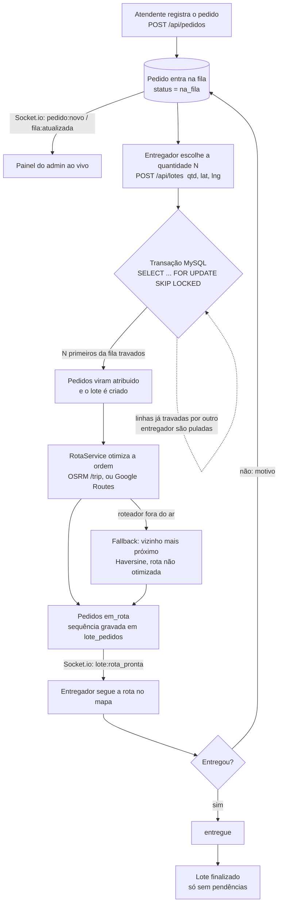

# Entrega Fila Água

> Sistema de entrega por fila para distribuidoras de água: o pedido entra numa fila, o entregador escolhe quantas entregas quer levar e o sistema monta a rota otimizada, sem que dois entregadores peguem o mesmo pedido.


---

## Como funciona

A fila **não é uma tabela separada**: é uma query sobre `pedidos` com
`status = 'na_fila'`, ordenada por **prioridade** (`urgente` > `vip` > `normal`)
e depois por **ordem de chegada** (`criado_em`).



### A trava de concorrência

Dois entregadores puxando ao mesmo tempo **nunca recebem o mesmo pedido**. O
`LotesService.criarLote` faz tudo numa única transação:

1. trava os N primeiros da fila com `SELECT ... FOR UPDATE SKIP LOCKED`; o
   segundo entregador pula as linhas já travadas e leva as próximas, sem espera
   e sem deadlock;
2. marca como `atribuido` com um UPDATE condicional (`AND status = 'na_fila'`);
3. cria o lote, calcula a rota e grava a sequência em `lote_pedidos`;
4. passa os pedidos para `em_rota` e registra em `auditoria` de onde veio a rota.

A `UNIQUE(pedido_id)` em `lote_pedidos` é a rede de segurança no banco.

### Ciclo de vida do pedido

- **Entregue:** `PATCH /lotes/:id/pedidos/:pedidoId/entregue`.
- **Não entregue** (com motivo, por exemplo `cliente_ausente`): o pedido **volta
  para a fila** e sai do lote, e outro lote pode puxá-lo depois.
- **Finalizar lote** com entregas pendentes é recusado (HTTP 400).
- **Reotimizar:** `POST /lotes/:id/reotimizar` recalcula a rota das entregas
  pendentes a partir da posição atual do entregador.
- **Cancelar** um pedido que está num lote remove o vínculo em `lote_pedidos`.
  Pedido já entregue não pode ser cancelado.

---

## Arquitetura

```
entrega-fila-agua/
├─ backend/     NestJS + TypeScript + TypeORM + Socket.io  (API em /api)
│  ├─ src/      auth, usuarios, clientes, produtos, pedidos, fila, lotes, geo, realtime
│  └─ scripts/  testes de ponta a ponta contra o backend local
├─ frontend/    React + Vite (PWA), Tailwind + componentes shadcn/ui, Leaflet
├─ db/          schema.sql (MySQL 8) + COMO_RODAR.md
└─ docs/        arquitetura.md (visão completa: fluxo, concorrência, modelo, endpoints)
```

### Perfis

O perfil (`admin`, `atendente` ou `entregador`) vai dentro do JWT, e as rotas são
protegidas por `JwtAuthGuard` + `RolesGuard`.

| Perfil | O que faz |
|---|---|
| **admin** | Painel com a fila ao vivo e os lotes em andamento; gerencia usuários (API), clientes e produtos. |
| **atendente** | Cadastra clientes (CEP, endereço e ponto no mapa) e produtos, e registra pedidos, que vão para a fila. |
| **entregador** | Escolhe quantas entregas puxar, recebe a rota no mapa, marca entregue ou não entregue e finaliza o lote. |

### Banco de dados

O `db/schema.sql` é a fonte da verdade. O TypeORM roda com `synchronize: false` e
**não altera o banco**. Há 8 tabelas: `usuarios`, `clientes`, `produtos`, `pedidos`,
`pedido_itens`, `lotes_entrega`, `lote_pedidos` e `auditoria`.

### Rota e geocodificação (sem chave de API)

| Peça | Serviço | Custo |
|---|---|---|
| CEP → rua, bairro, cidade | ViaCEP | grátis |
| Endereço → coordenadas | Nominatim (OpenStreetMap) | grátis |
| Ordem ótima das paradas | OSRM, serviço `/trip` | grátis |
| Mapa e traçado | Leaflet + tiles do OSM | grátis |
| Navegação turn-by-turn | deep link do Google Maps | grátis |

- **Cerca geográfica (`GEO_VIEWBOX`):** um endereço vago (por exemplo
  `"Av. Central, 1000"`, sem cidade) pode bater com uma rua de mesmo nome em outro
  estado. O que cai fora da área de operação é **recusado**, e o cliente fica
  sem coordenada (uma falha que o atendente vê) em vez de ficar com a coordenada
  errada (uma falha que ninguém percebe). A tela do atendente mostra os candidatos do
  geocodificador para alguém conferir.
- **Google como alternativa:** com `ROTA_PROVIDER=google` e `GOOGLE_MAPS_API_KEY`,
  o `RotaService` usa a Routes API (`computeRoutes` com `optimizeWaypointOrder` +
  `TRAFFIC_AWARE`), que considera o trânsito ao vivo. Exige billing ativo.
  `GEO_PROVIDER=google` faz o mesmo para a geocodificação.
- **Fallback:** se o roteador cair, o sistema não trava. Ele usa vizinho mais próximo
  (Haversine) e marca a rota como não otimizada.

### Tempo real (Socket.io)

Namespace `/realtime`, com rooms por perfil (`room:admins`, `room:atendentes`,
`room:entregador:<id>`). O socket **exige JWT no handshake**, e o perfil e o id
vêm do token, nunca do payload do cliente:

```ts
io(`${URL}/realtime`, { auth: { token: jwt } })
```

Eventos emitidos: `pedido:novo`, `fila:atualizada`, `pedido:status`,
`lote:criado`, `lote:rota_pronta`, `lote:pedido_entregue`, `lote:finalizado`,
`produto:atualizado` e `entregador:posicao`.

---

## Como rodar

### Pré-requisitos

- Node.js 18+ (recomendado 20 LTS)
- MySQL 8.0

### 1. Banco

```bash
cd db
mysql -u root -p < schema.sql
```

Esse comando cria o banco `entrega_fila_agua`, as 8 tabelas e o seed de produtos.
**Atenção:** o script faz `DROP TABLE` antes de recriar. Mais detalhes em
[`db/COMO_RODAR.md`](db/COMO_RODAR.md).

### 2. Backend

```bash
cd backend
npm install
cp .env.example .env      # ajuste DB_USER, DB_PASSWORD e JWT_SECRET
npm run seed              # cria as contas de teste (idempotente)
npm run start:dev         # http://localhost:3000/api
```

`JWT_SECRET` é **obrigatório**: sem ele, o backend não sobe. Para gerar um:

```bash
node -e "console.log(require('crypto').randomBytes(48).toString('base64'))"
```

### 3. Frontend

```bash
cd frontend
npm install
cp .env.example .env      # VITE_API_URL e VITE_SOCKET_URL já apontam para o backend local
npm run dev               # http://localhost:5173
```

### Contas de teste (criadas pelo `npm run seed`)

| Perfil | E-mail | Senha |
|---|---|---|
| admin | `admin@entrega-agua.local` | `admin123` |
| atendente | `atendente@entrega-agua.local` | `atendente123` |
| entregador | `entregador@entrega-agua.local` | `entregador123` |

Essas contas servem só para desenvolvimento. Troque as senhas antes de qualquer
uso real. As senhas ficam no banco como hash **bcrypt**.

### Variáveis de ambiente

Todas estão documentadas em `backend/.env.example` e `frontend/.env.example`. As principais:

| Variável | Onde | Para quê |
|---|---|---|
| `DB_HOST`, `DB_PORT`, `DB_USER`, `DB_PASSWORD`, `DB_NAME` | backend | conexão MySQL |
| `JWT_SECRET`, `JWT_EXPIRES_IN` | backend | assinatura do token (HTTP e socket) |
| `CORS_ORIGIN` | backend | origem do frontend |
| `ROTA_PROVIDER`, `OSRM_URL` | backend | roteador (`osrm` ou `google`) |
| `GEO_PROVIDER`, `NOMINATIM_URL`, `NOMINATIM_USER_AGENT` | backend | geocodificação |
| `GEO_VIEWBOX`, `GEO_COUNTRY`, `GEO_CIDADES` | backend | área de operação |
| `GOOGLE_MAPS_API_KEY` | backend | opcional, só com provedor `google` |
| `VITE_API_URL`, `VITE_SOCKET_URL` | frontend | endereço do backend |
| `VITE_OSRM_URL` | frontend | traçado da rota no mapa |
| `VITE_PARTIDA_PADRAO` | frontend | ponto de partida se o GPS for negado (precisa estar na área de operação) |

> O exemplo vem configurado para Fortaleza e Caucaia (CE). Para outra cidade,
> recalcule `GEO_VIEWBOX` com o `boundingbox` de cada município no Nominatim
> (`/search?q=<cidade>&format=jsonv2`) e una as caixas.

### Testes de ponta a ponta

Com o backend rodando e o seed aplicado, a partir de `backend/`:

```bash
node scripts/fluxo-test.cjs    # finalizar com pendência = 400; "não entregue" devolve à fila
node scripts/socket-test.cjs   # socket sem token / token inválido / escalada de perfil são recusados
```

O `socket-test.cjs` usa `socket.io-client` (`npm i -D socket.io-client`). O
`fluxo-test.cjs` cria os próprios dados (`ZZTESTE`) e apaga tudo no fim.

### Build de produção

```bash
cd backend  && npm run build && npm run start:prod
cd frontend && npm run build   # dist/ com service worker (PWA)
```

> `router.project-osrm.org` e `nominatim.openstreetmap.org` são servidores de
> **demonstração**: têm rate limit e não oferecem SLA. O backend já limita as chamadas ao
> Nominatim a 1 por segundo. Em produção, suba instâncias próprias e aponte
> `OSRM_URL` e `NOMINATIM_URL` para elas.

---

## Tecnologias

**Backend:** NestJS 10, TypeScript, TypeORM 0.3, MySQL 8 (`mysql2`), Socket.io 4,
Passport JWT, bcryptjs, class-validator.

**Frontend:** React 18, Vite 5, `vite-plugin-pwa`, React Router 6, Tailwind CSS 4,
componentes shadcn/ui (Radix), Leaflet, `socket.io-client`, axios, sonner.

**Serviços externos (gratuitos):** OSRM, Nominatim/OpenStreetMap e ViaCEP. Google
Routes e Geocoding são opcionais.

---

## Próximos passos

- **Mapa ao vivo dos entregadores no painel do admin:** o backend já recebe
  `entregador:posicao:update` e reemite `entregador:posicao` para `room:admins`
  (o id vem do token), mas o frontend ainda não envia nem exibe essa posição.
- **Monitoramento do admin:** `GET /dashboard` (métricas) e `GET /auditoria`
  (trilha com filtros) estão previstos em `docs/arquitetura.md`, mas ainda não
  foram implementados. A tabela `auditoria` já é preenchida.
- **Servidores próprios de OSRM e Nominatim** para produção, no lugar dos demos públicos.

---

Documentação técnica completa em [`docs/arquitetura.md`](docs/arquitetura.md).
