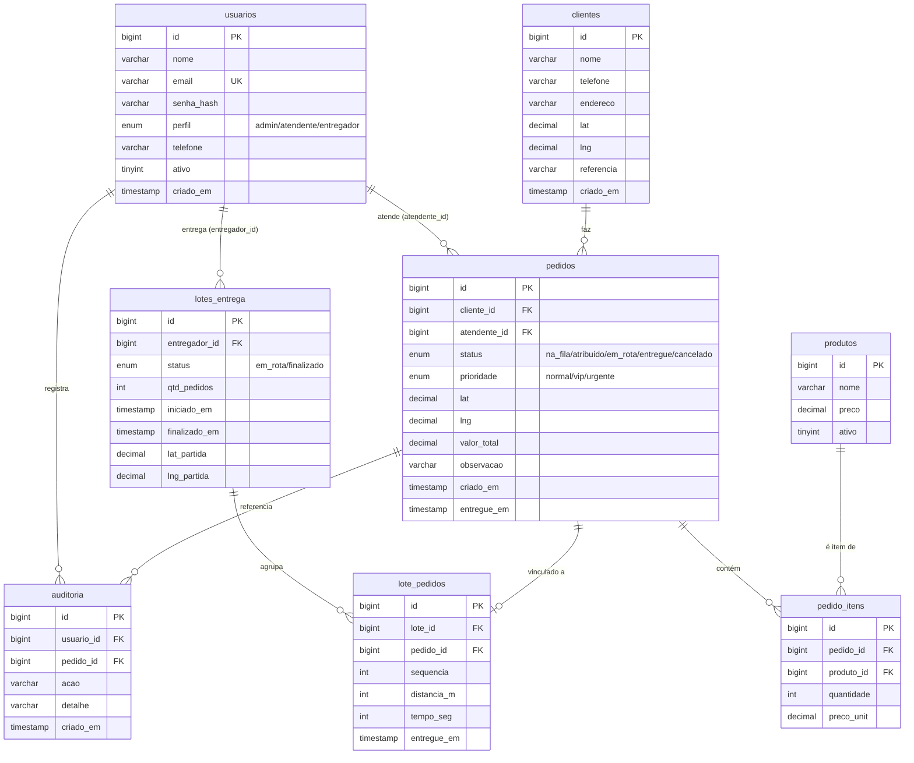

# Arquitetura — Sistema de Controle de Entrega por Fila (Entregadora de Água)

## 1. Visão geral

O sistema controla a entrega de água por **fila de pedidos**. Pedidos entram em uma
fila virtual; o entregador escolhe **quantas** entregas quer fazer no momento; o
sistema puxa essa quantidade da fila (com trava de concorrência) e um
**orquestrador** monta a **melhor rota otimizada** partindo do GPS atual do
entregador, usando a Google Routes API para minimizar o tempo considerando o
trânsito.

A "fila" **não** é uma tabela separada: é uma **query** sobre a tabela `pedidos`
filtrando `status = 'na_fila'` e ordenando por **prioridade** e depois por
**ordem de chegada** (`criado_em`). Isso mantém o modelo simples e evita
sincronização entre uma tabela-fila e a tabela de pedidos.

### Fluxo em uma frase

`atendente registra pedido → pedido entra na_fila → entregador puxa N →
orquestrador otimiza rota → entregador segue rota → cada entrega vira "entregue"
→ lote finalizado`.

---

## 2. Stack

| Camada        | Tecnologia                                                       |
|---------------|------------------------------------------------------------------|
| Backend       | NestJS + TypeScript                                              |
| Frontend      | React + Vite (PWA)                                               |
| Banco         | MySQL 8.0 + TypeORM (entities/decorators — **sem Prisma**)       |
| Tempo real    | Socket.io                                                        |
| Mapas / rota  | Google Maps Platform — Maps JavaScript SDK + **Routes API**      |
| Auth          | JWT (perfil embutido no token) + bcrypt para `senha_hash`        |

O frontend é um **PWA** para funcionar bem no celular do entregador (instalável,
cache de assets, uso do GPS do dispositivo via `navigator.geolocation`).

---

## 3. Os 3 perfis

O perfil fica em `usuarios.perfil` (ENUM `admin` / `atendente` / `entregador`) e é
carregado no JWT. As rotas do backend são protegidas por um **RolesGuard**.

- **admin** — monitora o sistema. Vê a fila em tempo real, lotes em rota,
  histórico, auditoria e dashboards. Pode gerenciar usuários, clientes e produtos.
- **atendente** — registra pedidos. Cadastra/seleciona cliente, monta os itens do
  pedido, define prioridade (normal/vip/urgente) e envia o pedido para a fila.
- **entregador** — puxa lote e recebe rota. Informa quantas entregas quer, recebe
  a sequência otimizada, navega, e marca cada pedido como entregue.

---

## 4. Fluxo da fila (passo a passo)

1. **Registro do pedido (atendente).** `POST /pedidos` cria o pedido com
   `status = 'na_fila'`, define `prioridade`, grava os itens em `pedido_itens`,
   calcula `valor_total` e resolve as coordenadas de entrega (`lat`/`lng`, herdadas
   do cliente ou geocodificadas). Um evento de socket `pedido:novo` é emitido para
   admins e entregadores atualizarem a fila.

2. **A fila é uma query.** Não existe tabela de fila. A fila corrente é sempre:

   ```sql
   SELECT *
   FROM pedidos
   WHERE status = 'na_fila'
   ORDER BY FIELD(prioridade, 'urgente', 'vip', 'normal'), criado_em ASC;
   ```

   Ou seja: primeiro **urgente**, depois **vip**, depois **normal**; dentro da
   mesma prioridade vale **FIFO** por `criado_em`. O índice composto
   `idx_pedidos_fila (status, prioridade, criado_em)` atende exatamente esse
   filtro + ordenação.

   > Observação: `prioridade` é um ENUM declarado na ordem
   > `('normal','vip','urgente')`. Para ordenar por severidade (urgente primeiro)
   > usamos `FIELD(...)` ou `ORDER BY prioridade DESC`. No exemplo acima usamos
   > `FIELD` por ser explícito e independente da ordem de declaração do ENUM.

3. **Entregador escolhe a quantidade N.** `POST /lotes` com `{ qtd, lat, lng }`.
   `lat`/`lng` são o **GPS atual** do entregador (ponto de partida da rota).

4. **Sistema puxa os N primeiros (com trava).** Dentro de uma **transação**, o
   backend seleciona os N primeiros pedidos da fila **travando as linhas**, muda o
   status para `atribuido`, cria o `lote_entrega` e vincula os pedidos em
   `lote_pedidos`. Ver seção 6 (concorrência).

5. **Orquestração da rota.** Com os N pedidos e o ponto de partida, o orquestrador
   chama a **Google Routes API** para obter a **melhor sequência** (menor tempo com
   trânsito). O resultado grava `sequencia`, `distancia_m` e `tempo_seg` em
   `lote_pedidos`, e o lote passa para `em_rota` (pedidos → `em_rota`). Ver seção 7.

6. **Entregador segue a rota.** O PWA mostra a sequência e navega. A cada entrega,
   `PATCH /lotes/:id/pedidos/:pedidoId/entregue` marca o pedido como `entregue`
   (`pedidos.entregue_em` e `lote_pedidos.entregue_em` preenchidos). Eventos de
   socket atualizam o admin em tempo real.

7. **Finalização do lote.** Quando todos os pedidos do lote foram entregues (ou
   cancelados), o lote vira `finalizado` (`finalizado_em` preenchido).

### Estados do pedido

```
na_fila ──► atribuido ──► em_rota ──► entregue
   │            │             │
   └────────────┴─────────────┴──────► cancelado
```

- `na_fila` — aguardando na fila.
- `atribuido` — reservado por um lote (trava aplicada), rota ainda sendo montada.
- `em_rota` — rota otimizada definida; entregador a caminho.
- `entregue` — entrega concluída.
- `cancelado` — cancelado pelo atendente/admin em qualquer ponto.

---

## 5. Orquestração da rota (passo a passo)

O **orquestrador** é um serviço do backend (`RotaService`) responsável por
transformar um conjunto de pedidos + ponto de partida em uma sequência ordenada.

1. **Entrada:** lista de pedidos do lote (cada um com `lat`/`lng`) + `lat_partida`
   / `lng_partida` (GPS do entregador).
2. **Chamada à Routes API** (`computeRoutes`) com:
   - `origin` = GPS do entregador;
   - `destination` = último ponto (ou o próprio depósito, se houver retorno);
   - `intermediates` = os pedidos como waypoints;
   - `optimizeWaypointOrder: true` (reordenação ótima dos waypoints);
   - `routingPreference: TRAFFIC_AWARE` (considera trânsito);
   - `travelMode: DRIVE`.
3. **Saída:** a API devolve `optimizedIntermediateWaypointIndex` (a ordem ótima) e,
   por trecho (`legs`), `distanceMeters` e `duration`. O orquestrador mapeia essa
   ordem de volta para os pedidos e grava `sequencia`, `distancia_m`, `tempo_seg`
   em `lote_pedidos`.
4. **Persistência + evento:** lote → `em_rota`; emite `lote:rota_pronta` via socket
   com a sequência para o entregador.

Se a Routes API falhar (timeout/limite), há **fallback** por heurística do
vizinho mais próximo (nearest-neighbor sobre distância Haversine) para não travar
a operação; a rota é marcada como "não-otimizada" para reprocessamento posterior.

---

## 6. Estratégia de concorrência (trava)

Dois entregadores nunca podem pegar o mesmo pedido. Isso é garantido por
**transação atômica** com trava de linha. Duas abordagens equivalentes, ambas
seguras em InnoDB:

### Abordagem A — `SELECT ... FOR UPDATE` (recomendada)

```sql
START TRANSACTION;

-- Trava as N primeiras linhas da fila. SKIP LOCKED evita que o
-- entregador 2 espere: ele simplesmente pula as linhas já travadas
-- pelo entregador 1 e pega as próximas disponíveis.
SELECT id
FROM pedidos
WHERE status = 'na_fila'
ORDER BY FIELD(prioridade, 'urgente', 'vip', 'normal'), criado_em ASC
LIMIT :N
FOR UPDATE SKIP LOCKED;

-- Com os ids travados, marca como atribuído e cria o vínculo do lote.
UPDATE pedidos
SET status = 'atribuido'
WHERE id IN (:ids);

INSERT INTO lotes_entrega (...) VALUES (...);
INSERT INTO lote_pedidos (lote_id, pedido_id, sequencia) VALUES ...;

COMMIT;
```

`FOR UPDATE` bloqueia as linhas selecionadas até o `COMMIT`; `SKIP LOCKED`
(MySQL 8.0+) faz o segundo entregador ignorar linhas já travadas em vez de
esperar, então cada um leva pedidos diferentes sem deadlock e sem espera.

### Abordagem B — UPDATE condicional (compare-and-set)

Sem `SELECT ... FOR UPDATE`, marca-se o status de forma condicional e confia-se no
número de linhas afetadas:

```sql
UPDATE pedidos
SET status = 'atribuido', /* opcional: coluna de reserva/lote */
WHERE status = 'na_fila'
  AND id IN ( /* ids escolhidos pela query da fila */ )
LIMIT :N;
-- Só "vencem" as linhas realmente alteradas (affectedRows).
-- Se outro entregador já mudou o status, o WHERE não casa e a linha não é pega.
```

O `WHERE status = 'na_fila'` é o ponto de atomicidade: apenas uma transação
consegue mudar cada linha de `na_fila` para `atribuido`. O backend usa
`affectedRows` para saber quais pedidos realmente conquistou.

**No projeto usamos a Abordagem A** (`FOR UPDATE SKIP LOCKED`) por lidar
naturalmente com N linhas ordenadas e alta concorrência. Além disso, a constraint
`UNIQUE (pedido_id)` em `lote_pedidos` é uma **rede de segurança** no banco: mesmo
que a lógica falhe, o banco recusa vincular o mesmo pedido a dois lotes.

No TypeORM isso é feito com `dataSource.transaction(async (manager) => { ... })`
e `manager.createQueryBuilder().setLock('pessimistic_write').setOnLocked('skip_locked')`.

---

## 7. Uso da Google Routes API

- **Endpoint:** `Routes API — computeRoutes` (`routes.googleapis.com`).
- **Objetivo:** otimizar a ordem dos waypoints e estimar tempo/distância com
  trânsito.
- **Campos principais do request:**
  - `origin` — GPS atual do entregador (`lat_partida`/`lng_partida`).
  - `intermediates` — os pedidos do lote como waypoints (`lat`/`lng`).
  - `destination` — último ponto da rota (ou depósito de retorno).
  - `travelMode: "DRIVE"`.
  - `routingPreference: "TRAFFIC_AWARE"` (ou `TRAFFIC_AWARE_OPTIMAL`).
  - `optimizeWaypointOrder: true` — pede a **ordem ótima** dos waypoints.
- **Campos usados da resposta** (via `FieldMask`):
  - `routes.optimizedIntermediateWaypointIndex` — a nova ordem dos waypoints.
  - `routes.legs.distanceMeters` / `routes.legs.duration` — por trecho, gravados
    em `lote_pedidos.distancia_m` / `tempo_seg`.
  - `routes.duration` / `routes.distanceMeters` — totais do lote.
- **No frontend:** o **Maps JavaScript SDK** desenha o mapa, os marcadores na
  ordem de `sequencia` e o traçado da rota; o GPS do aparelho alimenta a posição
  do entregador.
- **Boas práticas:** `FieldMask` restrito (só os campos usados) para reduzir custo;
  chave de API do lado do servidor para as chamadas de otimização; chave separada
  e restrita por domínio no frontend para o SDK de mapas.

---

## 8. Modelo do banco

Detalhes completos (tipos, índices, FKs, seed) em `db/schema.sql`. Resumo:



### Índices principais

- `usuarios`: único em `email`; índices em `perfil`, `ativo`.
- `pedidos`: `idx_pedidos_fila (status, prioridade, criado_em)` — serve a query da
  fila; mais `cliente_id`, `atendente_id`, `status`, `prioridade`, `criado_em`.
- `pedido_itens`: `pedido_id`, `produto_id`.
- `lotes_entrega`: `entregador_id`, `status`.
- `lote_pedidos`: únicos `(lote_id, pedido_id)`, `(lote_id, sequencia)` e
  `(pedido_id)` — este último garante que um pedido não fique em dois lotes.
- `auditoria`: `usuario_id`, `pedido_id`, `acao`, `criado_em`.

Preços/valores e lat/lng usam `DECIMAL`; status/perfil/prioridade usam `ENUM`;
timestamps têm default `CURRENT_TIMESTAMP`; charset `utf8mb4`.

---

## 9. Endpoints REST previstos

Prefixo sugerido `/api`. Todos (exceto login) exigem JWT; o RolesGuard restringe
por perfil.

### Auth
- `POST /auth/login` — `{ email, senha }` → `{ token, perfil }`.
- `GET  /auth/me` — dados do usuário logado.

### Usuários (admin)
- `GET/POST /usuarios`, `GET/PATCH/DELETE /usuarios/:id`.

### Clientes (atendente, admin)
- `GET/POST /clientes`, `GET/PATCH/DELETE /clientes/:id`.

### Produtos (admin)
- `GET /produtos` (todos), `POST/PATCH /produtos`, `PATCH /produtos/:id` (ativar/desativar).

### Pedidos
- `POST /pedidos` (atendente) — cria pedido + itens; entra `na_fila`.
- `GET /pedidos` — lista com filtros (`status`, `prioridade`, `cliente_id`).
- `GET /pedidos/:id` — detalhe.
- `PATCH /pedidos/:id/cancelar` — cancela (atendente/admin).

### Fila
- `GET /fila` — a fila corrente (query `status='na_fila'` ordenada por prioridade
  e `criado_em`), com contagem por prioridade.

### Lotes / entrega (entregador)
- `POST /lotes` — `{ qtd, lat, lng }`: puxa N da fila (transação + trava), monta
  rota otimizada, retorna o lote com a sequência.
- `GET /lotes/:id` — detalhe do lote e sequência.
- `GET /lotes?entregador_id=` — lotes do entregador.
- `PATCH /lotes/:id/pedidos/:pedidoId/entregue` — marca pedido como entregue.
- `PATCH /lotes/:id/finalizar` — finaliza o lote.
- `POST /lotes/:id/reotimizar` — recalcula a rota (ex.: fallback anterior).

### Monitoramento (admin)
- `GET /dashboard` — métricas (fila, lotes em rota, entregas do dia).
- `GET /auditoria` — trilha de auditoria com filtros.

---

## 10. Eventos de Socket.io previstos

Namespace `/realtime`. O servidor usa **rooms** por perfil e por entregador:
`room:admins`, `room:atendentes`, `room:entregador:<id>`.

### Servidor → cliente
- `pedido:novo` — novo pedido entrou na fila (para admins/atendentes).
- `fila:atualizada` — a fila mudou (novo, cancelado ou puxado por um lote).
- `pedido:status` — `{ pedidoId, status }` mudou de estado.
- `lote:criado` — um entregador puxou um lote (para admins).
- `lote:rota_pronta` — `{ loteId, sequencia[] }` rota otimizada disponível (para o
  entregador dono do lote).
- `lote:pedido_entregue` — `{ loteId, pedidoId }` entrega concluída.
- `lote:finalizado` — lote encerrado.
- `entregador:posicao` — posição GPS do entregador em rota (para o admin
  acompanhar no mapa).

### Cliente → servidor
- `entregador:posicao:update` — `{ lat, lng }` o PWA do entregador envia a posição
  periodicamente enquanto em rota.
- `subscribe` / `unsubscribe` — entra/sai de rooms conforme o perfil.

### Auditoria

Toda ação relevante (criação, atribuição a lote, mudança de status, cancelamento,
entrega) grava uma linha em `auditoria` com `usuario_id`, `pedido_id`, `acao` e
`detalhe` — para rastreabilidade e para o dashboard do admin.
